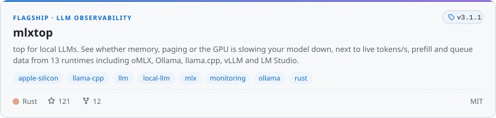
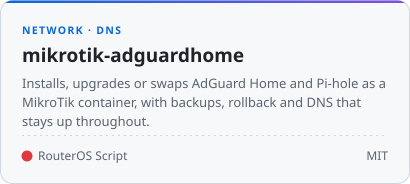
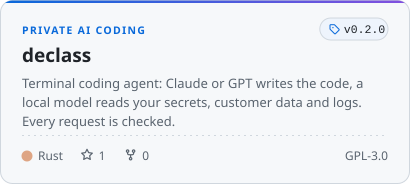

<picture>
  <source media="(prefers-color-scheme: dark)" srcset="assets/banner-dark.svg">
  
</picture>

I build developer tools for people who run AI on their own machines. **[mlxtop](https://github.com/maximpri/mlxtop)** shows whether memory, paging or the GPU is what's slowing a local model down. **[Declass](https://github.com/maximpri/declass)** lets Claude or GPT write your code while a local model handles the `.env`, customer data and logs. It grew out of my experience at major regulated financial institutions, where you have to know exactly what data leaves the building.

Most of my work is in Rust. Installers, routers and glue are written in shell, Python and RouterOS script.

## Featured

<p>
<a href="https://github.com/maximpri/mlxtop"><picture>
  <source media="(prefers-color-scheme: dark)" srcset="assets/card-mlxtop-dark.svg">
  
</picture></a>
</p>

<details>
<summary><b>See mlxtop in action</b></summary>
<br>
<a href="https://github.com/maximpri/mlxtop"></a>
</details>

<p>
<a href="https://github.com/maximpri/mikrotik-adguardhome"><picture>
  <source media="(prefers-color-scheme: dark)" srcset="assets/card-mikrotik-adguardhome-dark.svg">
  
</picture></a>
<a href="https://github.com/maximpri/declass"><picture>
  <source media="(prefers-color-scheme: dark)" srcset="assets/card-declass-dark.svg">
  
</picture></a>
</p>

**Also on GitHub:** [CodexResets](https://github.com/maximpri/CodexResets) shows when your Codex usage limits reset and when a banked reset is worth using. [win2mac-remap](https://github.com/maximpri/win2mac-remap) makes a Windows keyboard feel native on a Mac.

## Try it

```sh
brew install maximpri/tap/mlxtop    # macOS and Linux; Windows installer in the repo
mlxtop
```

<sub>The banner and cards are SVGs rendered from live GitHub data by <a href="scripts/render.py">scripts/render.py</a> and refreshed daily.</sub>
